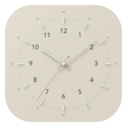
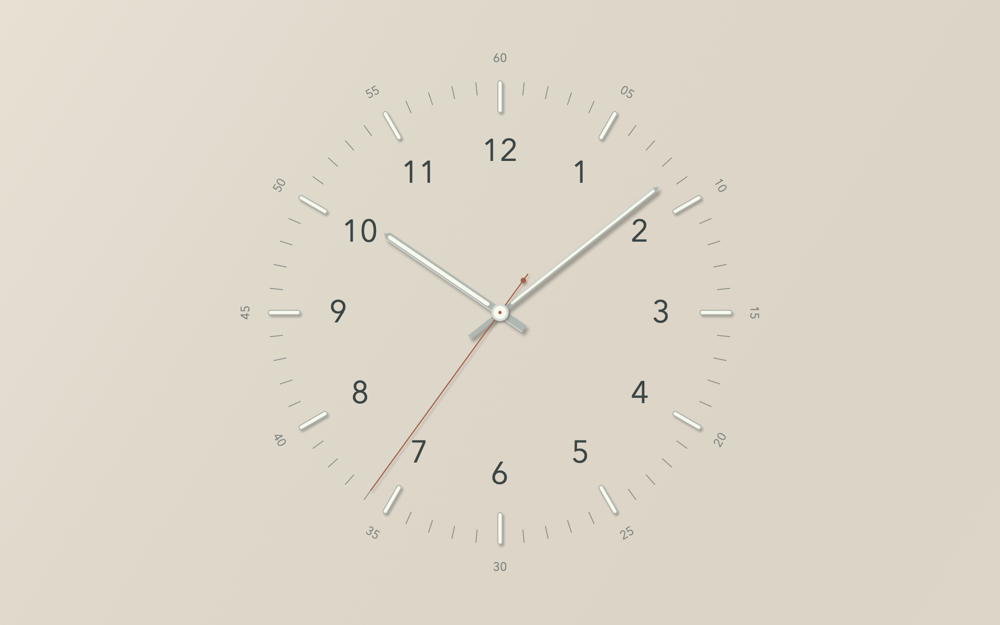
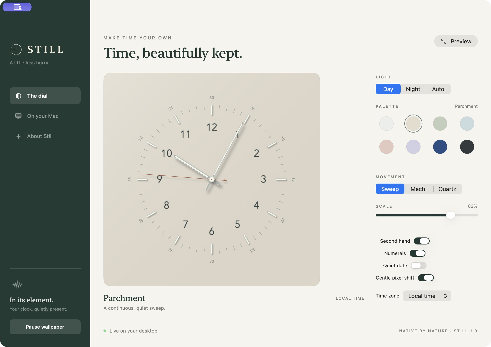
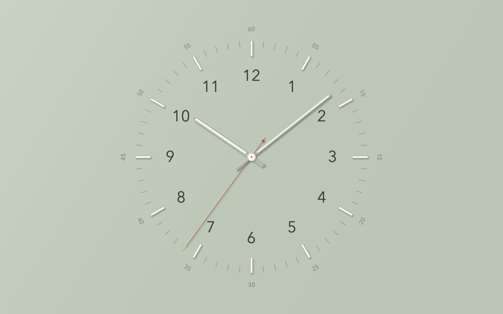
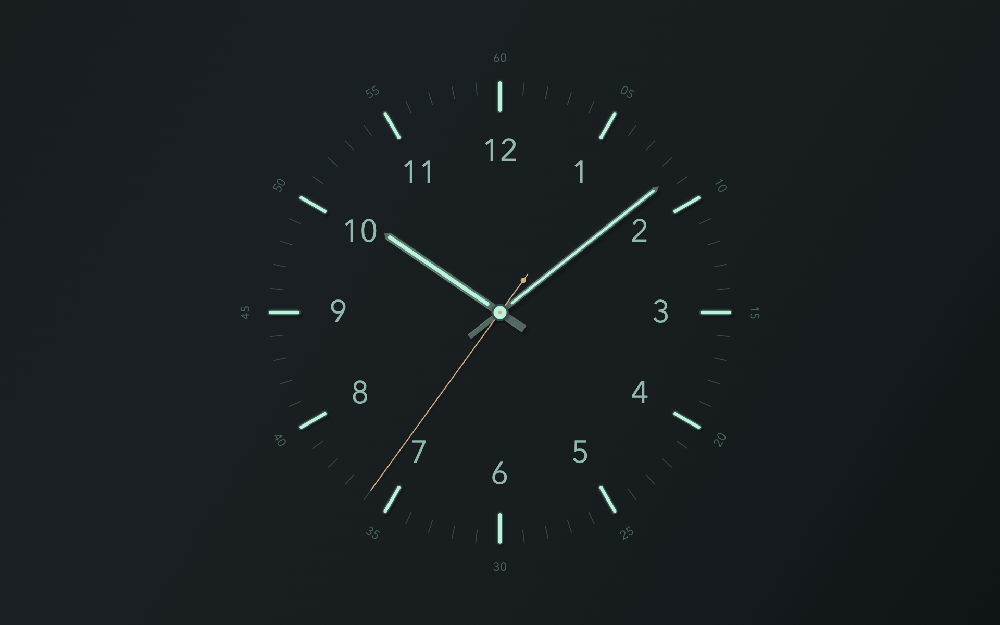

<p align="center"></p>
<h1 align="center">Still Clock</h1>
<p align="center"><strong>A little less hurry.</strong><br>A sculpted analogue clock for your macOS desktop and screen saver.</p>
<p align="center"><a href="https://github.com/ded-furby/still-clock/releases/latest">Download</a> · <a href="docs/SETUP.md">Setup guide</a> · <a href="#build-in-one-command">Build</a> · <a href="docs/ARCHITECTURE.md">Architecture</a></p>
<p align="center"></p>



Still brings a quiet, tactile clock to the places where you leave a little space. Raised luminous indices, fine minute marks, geometric numerals, metal-edged hands, and soft directional light. Everything is drawn natively with Core Graphics. No web view, account, network connection, or subscription.

## Get started

1. Download **StillClock-1.0.0-universal.dmg** from [Releases](https://github.com/ded-furby/still-clock/releases/latest).
2. Drag **Still Clock.app** into **Applications**, then open it.
3. Click **Use as wallpaper** for a live clock behind your desktop icons.
4. Open **On your Mac → Install screen saver**. In macOS settings, choose **Still Clock**.
5. For a password-protected clock, set **Lock Screen → Require password → Immediately**. Start the system screen saver from Still’s menu-bar menu.

**Distribution status:** this release is ad-hoc signed, not Apple-notarized. macOS may block a downloaded copy. Use the standard **Privacy & Security → Open Anyway** flow only if you trust this source, or build locally. Do not disable Gatekeeper or SIP. A locally built app does not need a paid developer account.

### What “locked screen” means

Still has two native components:

| Surface | What you see |
| --- | --- |
| Desktop | A real-time clock behind your icons, across connected displays and desktop Spaces |
| Screen saver | The same clock, rendered by macOS’s screen saver host; password protection follows your Lock Screen settings |
| Password-entry / login / FileVault screen | Owned by macOS; Still does not replace or overlay it |
| Sleeping display | Off; Still respects your power settings |

Use **Start system screen saver** with immediate password protection for the clock-while-away experience. **Control–Command–Q** first shows Apple’s lock UI; it is not a guaranteed direct shortcut into a third-party screen saver. Still’s full-screen **Preview** is only a preview and does not lock your Mac.

## A simple native control room



## A dial that feels considered

- Eight palettes: Porcelain, Parchment, Sage, Glacier, Rose, Lavender, Cobalt, and Graphite.
- A luminous night dial, plus automatic system appearance.
- Continuous sweep at 30 fps, mechanical eight-step movement (28,800 beats/hour), or a one-second quartz tick.
- Adjustable size, optional numerals, second hand, and a discreet date.
- Local time or Sydney, London, New York, Tokyo, and UTC.
- Gentle position drift in the wallpaper and screen saver. This reduces static exposure; it is not a guarantee against burn-in.
- Multiple displays, Retina rendering, reduced-motion support, accessible controls, and a spoken time value for the preview.
- A menu-bar companion, optional launch at login, and an in-app screen saver installer.
- Cached dial artwork; only the moving hands are composed each frame. Desktop drawing pauses while displays sleep or the session is inactive, and skips fully occluded windows.

<table><tr><td></td><td></td></tr></table>

## Build in one command

Requires macOS 13+ and Apple’s Command Line Tools. No package downloads and no Xcode project generation.

```sh
xcode-select --install # only if the Command Line Tools are missing
git clone https://github.com/ded-furby/still-clock.git
cd still-clock
make build
open "build/Still Clock.app"
```

| Command | Result |
| --- | --- |
| `make build` | App and screen saver for this Mac’s architecture |
| `make test` | Clock, preference, renderer, and built screen saver checks; no XCTest required |
| `make universal` | Apple Silicon + Intel bundles |
| `make package` | Universal DMG, ZIP, and SHA-256 checksums in `dist/` |
| `make artwork` | Regenerate the app icon and screen saver thumbnail |
| `swift test` | Additional XCTest suite; requires full Xcode with XCTest |

The Swift package can also be opened directly in Xcode. `swift run` runs the settings app, but the in-app installer requires the packaged `.app` produced by `make build`.

## Project map

```text
Sources/ClockCore/      Clock math, palettes, drawing, shared settings and preview
Sources/StillClock/     Native settings app, wallpaper windows and menu bar
Sources/StillSaver/     macOS ScreenSaverView plug-in and options sheet
Scripts/               Dependency-free build, checks, artwork and packaging
Tests/                 XCTest regression suite
Resources/             Original generated icon and thumbnail
docs/                  Setup, architecture, validation and original preview images
```

## Verification & support

The build checks both bundle signatures. The native smoke test loads the actual `.saver`, resolves its principal class, opens its configuration view, draws it, and verifies start/stop behavior. Tests cover hour interpolation, mechanical cadence, fractional time zones, Sydney daylight-saving rollover, corrupted preferences, persistence, bounded drift, and every palette at preview and Retina sizes.

See [validation](docs/VALIDATION.md) for what has actually been exercised, including platform limits. Report bugs using the issue template, with your macOS version and whether the problem occurs in the desktop, preview, or system screen saver.

## Credits & license

Inspired by the visual direction of [Bauhaus Clock](https://bauhausclock.com/) and classic instrument dials. Still is an independent implementation and is not affiliated with Bauhaus Clock. All shipped graphics are generated from this repository’s renderer; no source code, paid binaries, fonts, photographs, or website assets from the reference product are included. The renderer uses macOS’s installed Avenir Next, with a system-font fallback.

[MIT](LICENSE). See [Contributing](CONTRIBUTING.md) and [Security](SECURITY.md).
